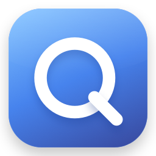

<picture>
  <source media="(prefers-color-scheme: dark)" srcset="assets/header-dark.svg">
  
</picture>

### Зараз

- 🛠 Будую **Questionio** — AI-копілот для macOS, який сам чує питання в розмові й за секунду показує відповідь.
- 🧠 Цікавить AI на пристрої: розпізнавання мови, швидкі моделі, інтерфейси, які не заважають.
- 🎨 Люблю, коли все доведено до дрібниць: від затримки в мілісекундах до тіні під карткою.

### Questionio

**AI-помічник для дзвінків, співбесід і пар на macOS.** Слухає співрозмовника, сам знаходить питання й показує готову відповідь у плаваючій панелі. Читає ваш код, конспекти й вікно перед вами, а на прохання ховається від запису екрана. Swift · SwiftUI · Parakeet на Neural Engine · Claude, Gemini, Ollama.

 

<table>
  <tr>
    <td width="60%"></td>
    <td width="40%"></td>
  </tr>
  <tr>
    <td align="center">Питання про те, що на екрані</td>
    <td align="center">«Хамелеон» підлаштовується під фон</td>
  </tr>
</table>

- **≈1 с** від кінця питання до першого слова відповіді
- **Розпізнавання на Mac**, українська й англійська в одній розмові
- **Ghost:** панель не видно в записі й демонстрації екрана
- **Хамелеон:** панель зливається з вікном позаду, а текст лишається чітким

Код приватний — вище демо з вбудованого демо-режиму.

### Стек

<picture>
  <source media="(prefers-color-scheme: dark)" srcset="https://skillicons.dev/icons?i=swift,apple,ts,react,nextjs,tailwind,threejs,angular,py,fastapi,docker,java,cs,git&theme=dark&perline=14">
  
</picture>
