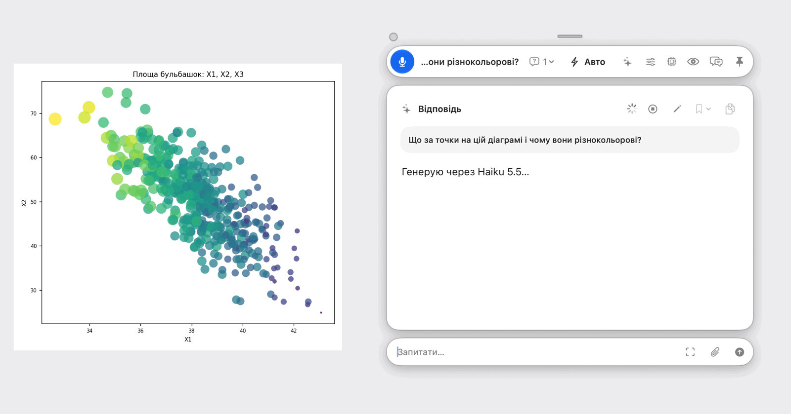

  

## Активність

<picture>
  <source media="(prefers-color-scheme: dark)" srcset="https://streak-stats.demolab.com?user=illyaterescho&locale=uk&date_format=j%20M%5B%20Y%5D&card_width=880&background=0D1117&border=30363D&stroke=30363D&ring=39D353&fire=39D353&currStreakNum=E6EDF3&sideNums=E6EDF3&currStreakLabel=39D353&sideLabels=8B949E&dates=8B949E">
  
</picture>

<picture>
  <source media="(prefers-color-scheme: dark)" srcset="https://github-readme-activity-graph.vercel.app/graph?username=illyaterescho&area=true&radius=6&height=300&custom_title=%D0%90%D0%BA%D1%82%D0%B8%D0%B2%D0%BD%D1%96%D1%81%D1%82%D1%8C%20%D0%BF%D0%BE%20%D0%B4%D0%BD%D1%8F%D1%85&bg_color=0d1117&color=8b949e&title_color=e6edf3&line=39d353&point=26a641&area_color=0e4429&border_color=30363d">
  
</picture>

## Стек

  &nbsp;&nbsp;
  &nbsp;&nbsp;
  &nbsp;&nbsp;
  &nbsp;&nbsp;
  &nbsp;&nbsp;
  &nbsp;&nbsp;
  &nbsp;&nbsp;

  <picture>
    <source media="(prefers-color-scheme: dark)" srcset="https://skillicons.dev/icons?i=swift%2Cts%2Cnextjs%2Ctailwind%2Cthreejs%2Cphp%2Cfastapi%2Cdocker%2Cjava%2Ccs%2Ccpp&theme=dark">
    
  </picture>

##  Questionio

**AI-помічник для дзвінків, співбесід і пар на macOS.** Слухає співрозмовника, сам знаходить питання й показує готову відповідь у плаваючій панелі. Читає код, конспекти й вікно перед вами, а на прохання ховається від запису екрана. Swift · SwiftUI · Parakeet на Neural Engine · Claude, Gemini, Ollama.

 

<table>
  <tr>
    <td width="60%"></td>
    <td width="40%"></td>
  </tr>
  <tr>
    <td align="center">Питання про те, що на екрані</td>
    <td align="center">«Хамелеон» підлаштовується під фон</td>
  </tr>
</table>

Код приватний — вище демо з вбудованого демо-режиму.

## Цифри

<picture>
  <source media="(prefers-color-scheme: dark)" srcset="assets/metrics-dark.svg">
  
</picture>
