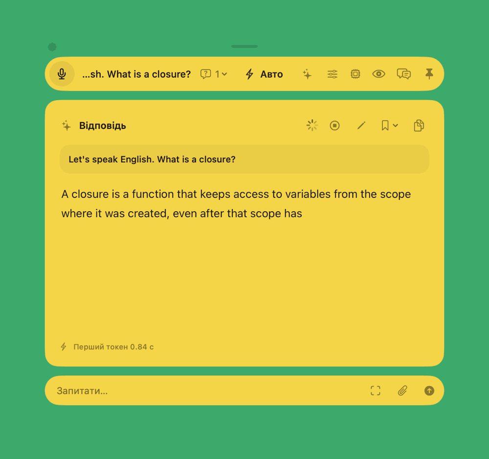

  

<picture>
  <source media="(prefers-color-scheme: dark)" srcset="assets/snake-dark.svg">
  <source media="(prefers-color-scheme: light)" srcset="assets/snake.svg">
  
</picture>

## Стек

  &nbsp;&nbsp;
  &nbsp;&nbsp;
  &nbsp;&nbsp;
  &nbsp;&nbsp;
  &nbsp;&nbsp;
  &nbsp;&nbsp;
  &nbsp;&nbsp;

  <picture>
    <source media="(prefers-color-scheme: dark)" srcset="https://skillicons.dev/icons?i=swift%2Cts%2Cnextjs%2Ctailwind%2Cthreejs%2Cphp%2Cfastapi%2Cdocker%2Cjava%2Ccs%2Ccpp&theme=dark">
    
  </picture>

##  Questionio

**AI-помічник для дзвінків, співбесід і пар на macOS.** Слухає співрозмовника, сам знаходить питання й показує готову відповідь у плаваючій панелі. Читає код, конспекти й вікно перед вами, а на прохання ховається від запису екрана. Swift · SwiftUI · Parakeet на Neural Engine · Claude, Gemini, Ollama.

 

<table>
  <tr>
    <td width="60%"></td>
    <td width="40%"></td>
  </tr>
  <tr>
    <td align="center">Питання про те, що на екрані</td>
    <td align="center">«Хамелеон» підлаштовується під фон</td>
  </tr>
</table>

Код приватний — вище демо з вбудованого демо-режиму.

## Цифри

<picture>
  <source media="(prefers-color-scheme: dark)" srcset="assets/metrics-dark.svg">
  
</picture>
